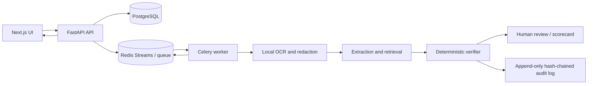

# EcoChain Copilot

EcoChain Copilot is a local-first compliance assessment prototype for supplier
documents. It extracts evidence, applies deterministic verification rules,
produces an auditable scorecard, and routes uncertain cases to human review.
The LLM is limited to explanations; it cannot set or change verifier outcomes.

## Architecture



Documents and raw PII remain inside the application trust boundary. External
LLM requests are disabled in the local demo path and must pass the outbound
privacy guard when enabled.

## 10-minute local quickstart

Prerequisites: Windows PowerShell, Python 3.12, Docker Desktop with Compose,
and network access to download container/model dependencies. The Compose
defaults are development-only and bind ports to localhost.

```powershell
# From the repository root
docker info
py -3.12 -m venv .venv
.\.venv\Scripts\python.exe -m pip install -r requirements.txt

# Keep the full-stack ports separate from docker\compose.dev.yml (5432/6379).
$env:POSTGRES_PORT = "5433"
$env:REDIS_PORT = "6380"

# Build and start PostgreSQL, Redis, API, worker, and frontend.
docker compose up -d --build --wait

# Confirm readiness and run the deterministic 150-case demo.
curl.exe --fail http://127.0.0.1:8000/readyz
docker compose exec -T api python -m scripts.run_demo
```

The frontend is served at <http://127.0.0.1:3000> and the API at
<http://127.0.0.1:8000>. A demo login account is not created automatically.
To run database-backed tests, start the isolated development services and
apply migrations using [the runbook](docs/RUNBOOK.md). If PowerShell blocks the
unsigned integration script, the runbook includes an equivalent direct
`.venv\Scripts\python.exe -m pytest` command. If `.env` already exists, preserve
it and merge any missing settings from `.env.example` rather than overwriting it.

```powershell
.\scripts\test_integration.ps1
.\.venv\Scripts\python.exe -m pytest backend\tests -q
```

Stop the full-stack Compose project with `docker compose down`. This preserves
its named volumes; do not add `--volumes` unless you intend to delete local
database and Redis data.

## Security and operations

See [Security](docs/SECURITY.md) for trust boundaries, controls, and residual
risks, and [the runbook](docs/RUNBOOK.md) for service operations and recovery.
Evaluation evidence and current phase status are in [docs/PROGRESS.md](docs/PROGRESS.md).

## Known limitations

- Evaluation documents and metrics are primarily synthetic; they do not
  establish real-world accuracy or regulatory suitability.
- The issuer registry is mock data and the regulation corpus is manually
  curated; external providers are not enabled in the local workflow.
- Redaction and outbound checks reduce risk but cannot guarantee that all PII
  is detected or that every document is safe.
- Prompt-injection tests prove verifier invariance for tested cases, not
  universal immunity of generated explanations.
- LayoutLMv3 pretrained weights have a non-commercial CC BY-NC-SA 4.0
  constraint. Verify licensing before any commercial deployment.
- The local Compose credentials, fake LLM configuration, and development
  secrets are not production settings. Configure managed secrets, TLS,
  restricted network access, backups, and monitoring before deployment.
- Optional Ragas faithfulness and answer relevance metrics remain `not_run`
  until the guarded external evaluation is explicitly configured.
