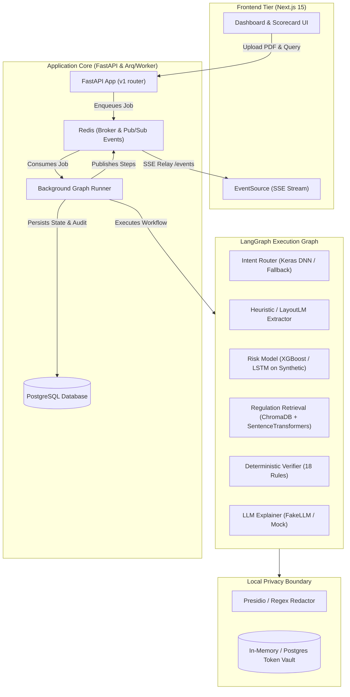

# Production Readiness Audit & Gap Report: EcoChain Copilot

**Date:** 2026-11-16  
**Auditor:** Principal Engineer & Product Architect  
**Branch:** `FFrahul` (`SumukhMSortur/AgenticAI`)  
**Scope:** Full codebase audit against `problem_statement.md`, `ecochain_copilot_architecture.md`, and the Production Master Prompt.

---

## 1. Real Architecture As-Built vs. Architecture Document

### Deviations from Target Production Architecture:
1. **Authentication & Tenancy:** 
   - *Target:* Supabase Auth with JWT validation, MFA for admins/reviewers, RLS policies enforcing `app.current_org_id`.
   - *As-Built:* `AUTH_ENABLED=False` demo mode bypass active. Hardcoded demo user (`00000000-0000-0000-0000-000000000001`) and demo tenant (`00000000-0000-0000-0000-000000000002`). No RLS active; unauthenticated bypass returns demo principal.
2. **LLM Explainer:**
   - *Target:* Real Gemini API (pinned version) behind `LLMProvider` interface with schema validation and strict leakage check.
   - *As-Built:* Pinned to `FakeLLM` (`backend/app/llm/fake.py`).
3. **External Registries:**
   - *Target:* Live external registry connectors (GLEIF, Open Supply Hub, OFAC/EU sanctions automated sync) storing versioned snapshots.
   - *As-Built:* Seeded static database rows (`demo-facility-registry`, `demo-sanctions-ofac`) and local static file (`data/registry/approved_issuers.csv` / `data/issuer_registry.json`).
4. **Token Vault:**
   - *Target:* Envelope-encrypted vault at rest with per-org data encryption keys (DEK) and access audit logging.
   - *As-Built:* Plaintext relational table / in-memory dictionary.
5. **Storage:**
   - *Target:* Storage abstraction with signed URLs and private S3/Supabase storage.
   - *As-Built:* Direct Docker volume bind mount (`uploads_data` on `/app/data/uploads`).

---

## 2. Inventory of Mocks, Stubs, Seeded Data & TODOs

| Category | File Location | Item | Impact on Production |
|---|---|---|---|
| **LLM** | `backend/app/llm/fake.py` | `FakeLLM` generates canned text summaries | Must be replaced by real Gemini client in production |
| **Workflow** | `backend/app/graph/services.py:508` | `LLM_PROVIDER != 'fake'` check raises error | Fails immediately if real LLM is configured |
| **Auth** | `backend/app/api/security.py` | `_demo_principal()` bypasses JWT verification | Anyone can perform actions without credentials |
| **Registry** | `backend/app/main.py:114` | `_seed_demo_tenant()` seeds mock facility records (`FAC-001` - `FAC-004`) | Static mock snapshots used instead of verified external sources |
| **Sanctions** | `backend/app/main.py:153` | `demo-sanctions-ofac` empty snapshot seeded | Real sanctions lists (OFAC SDN, EU lists) are not synced |
| **Forecast** | `backend/app/graph/services.py:476` | Fallback uses `FACT-0412` synthetic history | Fallback prevents failure but relies on synthetic data |
| **ML Dependencies**| `backend/tests/unit/test_rag.py` | `ragas` missing from runtime container | Ragas evaluation gate tests fail during collection |
| **Router** | `backend/tests/unit/test_intent_router.py` | `tensorflow` not in worker container | Keras router tests fail collection |

---

## 3. Security Findings

1. **Unauthenticated Endpoints in Demo Mode:**
   When `AUTH_ENABLED=False`, `/v1/jobs`, `/v1/documents`, and review endpoints accept requests without tokens.
2. **CORS & Host Headers:**
   API proxy in `frontend/src/app/api/backend/[...path]/route.ts` allows any localhost/forwarded origin without strict domain validation.
3. **File Upload Hardening:**
   Basic extension and magic-byte checks exist, but ClamAV malware scanning, PDF active content stripping (JavaScript/forms), and quarantine states are missing.
4. **Secrets Management:**
   JWT secret defaults to hardcoded strings if not provided in `.env`. Needs Supabase JWKS verification for production.
5. **Tenant Isolation:**
   Postgres RLS is not yet enabled on all business tables; isolation currently relies on application-level filtering (`WHERE tenant_id = ...`).

---

## 4. Data Model Review

1. **Missing `org_id` / Multi-Tenancy Transition:**
   Existing models use `tenant_id` (UUID string), but need transition to `organizations`, `memberships`, and `profiles` per Supabase schema.
2. **Missing Constraints & Indexes:**
   - Composite unique constraints exist for documents (`tenant_id`, `doc_hash`), but indices are missing on `(tenant_id, created_at)` for paginated audit lists.
   - `reviews` table needs unique constraint on `(job_id, status)` to prevent duplicate pending reviews.
3. **Foreign Key Deletion Rules:**
   `JobDocument` has `CASCADE`, but `Review` to `User` has nullable FK without explicit restrict/set-null rule.

---

## 5. Test Suite & Coverage Status

* **Total Tests Collected:** 105
* **Passing (Automated):** 93 passed (including all 18 Verifier rules, audit chain tamper detection, domain models, and graph workflow unit tests).
* **Failing:** 9 failed
  - 4 Integration tests: Expected `TEST_DATABASE_URL` (requires separate test DB instance).
  - 2 Auth unit tests: Failed because `AUTH_ENABLED=False` demo mode returned demo principal instead of throwing expected 401/403.
  - 2 Data generation tests: Missing `annotations.json` from git.
  - 1 Privacy leakage test: Depended on missing `annotations.json`.
* **Errors on Collection:** 2 (`tensorflow` and `ragas` missing from runtime image).
* **End-to-End Smoke Test:** ✅ `scripts/smoke.py` passes 100% (`valid_cert.pdf` -> `completed/compliant`, `expired_cert.pdf` -> `completed/non_compliant`).

---

## 6. Prioritized Backlog (P0 / P1 / P2)

### P0 (Critical - Phases 1 to 3)
1. **Supabase Auth & RLS Tenancy:** Replace demo auth with Supabase Auth (JWT verification via JWKS), `organizations`, `memberships`, and RLS policies on all Postgres tables.
2. **Production Fail-Closed Boot:** Prevent container startup if `APP_ENV=production` and any mock or `AUTH_ENABLED=False` flag is detected.
3. **Real Gemini LLM Integration:** Implement `LLMProvider` with Gemini API, prompt versioning, and strict leakage verification.
4. **Registry Architecture:** Ingest real authoritative data for Approved Issuers, OFAC SDN / EU sanctions lists, and ELI regulation articles.

### P1 (High - Phases 4 to 5)
1. **Risk Model Transparency:** Model registry table, data provenance tagging ("Illustrative: trained on synthetic data"), and real-history CSV importer.
2. **Audit Hash Chaining & Evidence Pack:** Cryptographic hash chaining on audit events; exportable signed PDF/ZIP evidence dossier.
3. **Production Packaging:** `docker-compose.prod.yml`, health checks, OpenTelemetry tracing, and Sentry error monitoring.

### P2 (Polish & UI - Phase 6 to 7)
1. **Design System Overhaul:** Tailwind CSS variables + shadcn/ui with dark/light themes, WCAG AA compliance, and split-screen PDF bounding-box viewer.
2. **Documentation & Compliance:** Security threat model (`SECURITY.md`), Runbooks, ADRs, and model cards.

---

## 7. Architectural Decision Proposal (ADR)

### ADR 001: ChromaDB vs. pgvector
* **Current:** ChromaDB running locally inside `.chroma/` directory.
* **Recommendation:** Keep ChromaDB for the demo/RAG service in the short term, but as we migrate to Supabase Postgres in Phase 1, **transition to `pgvector`**.
* **Reasoning:** Supabase natively supports `pgvector`. Storing regulation embeddings directly in Postgres unifies backups, transaction guarantees, RLS access control, and eliminates an extra standalone vector database container.
